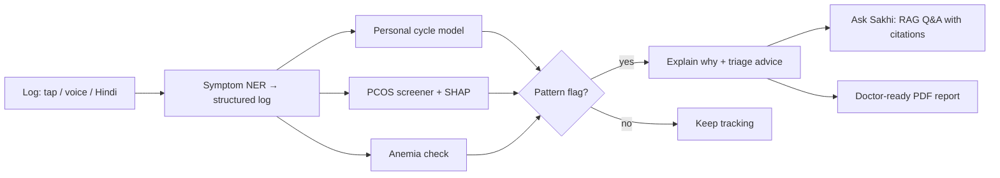
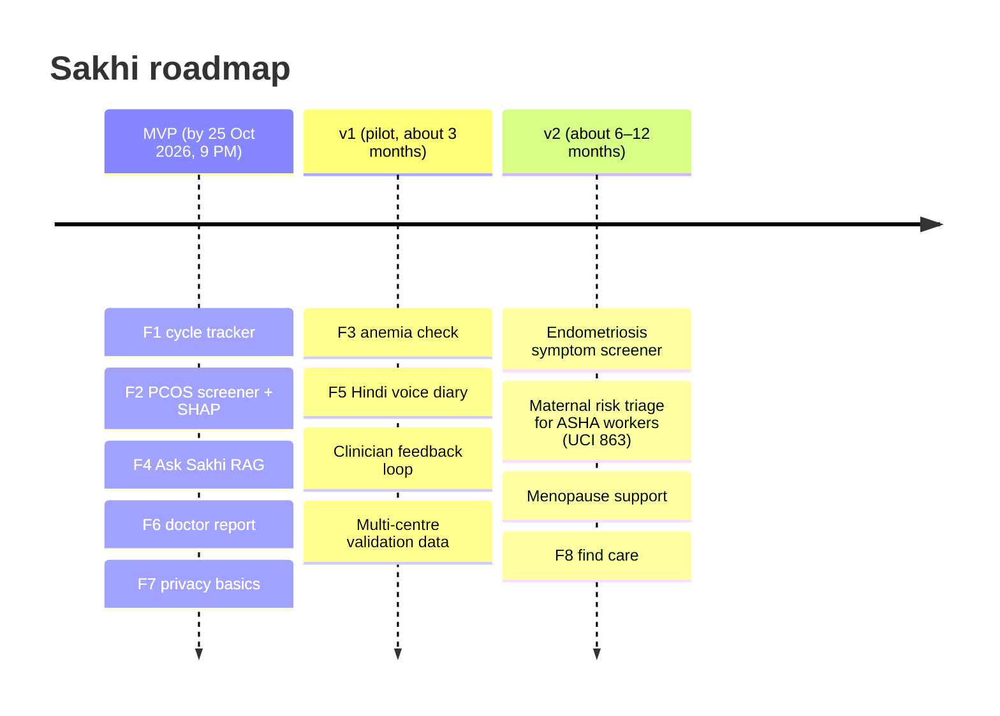

# PRD: Sakhi, niche women's health features

> **Summary:** Sakhi (working name) is a private companion that works in Hindi and English. It helps young Indian women spot early signs of **PCOS, irregular cycles and anemia**, then walk into a doctor's visit with a clear one-page summary. Sakhi screens and guides. **It never diagnoses.**
> Deadline: a working MVP committed by **Sun 25 Oct 2026, 9:00 PM IST**. See [[00 - Rulebook & Problem Statements]].

Related notes: [[01 - PS1 Healthcare - Pretrained Models]] · [[02 - PS1 Healthcare - Datasets & Papers]] · [[03 - Reference Material Review]]

---

## 0. Rulebook compliance

The feature set has been checked against [[00 - Rulebook & Problem Statements]]. ✅ = complies by design. ⚠️ = complies only if the team takes the stated action.

| Rule                                                  | Status | How Sakhi complies                                                                                                                                                         |
| ----------------------------------------------------- | ------ | -------------------------------------------------------------------------------------------------------------------------------------------------------------------------- |
| Fits a problem statement                              | ✅     | **PS1**: diagnosis gaps (F2, F3), symptom tracking (F1, F5), health awareness (F4), clinical insights (F6)                                                           |
| PS chosen before 3 PM Sat, never changed              | ⚠️   | Submit the form with PS1 before 3 PM Sat 24 Oct                                                                                                                            |
| All development inside Sat 3 PM – Sun 9 PM           | ⚠️   | Only this PRD and research exist before 3 PM. No code is written or committed earlier.                                                                                     |
| No commit after 9 PM Sun                              | ⚠️   | Freeze at 8:30 PM (build order step 10)                                                                                                                                    |
| No plagiarism; reference repos are inspiration only   | ✅     | F1 no longer reuses Femora code. No forks. All code is original.                                                                                                           |
| Pretrained models via API or Hugging Face             | ✅     | MedGemma, MedCPT, IndicConformer, IndicTrans2 and the NER model are all pretrained. The only trained models (PCOS, anemia) are small tabular models that train in minutes. |
| Third-party items allowed only if the licence permits | ⚠️   | Confirm the Kaggle dataset licences and MedGemma's HAI-DEF terms before use                                                                                                |
| Credit everything in README **and** PPT         | ⚠️   | Required deliverable (§5 Credits)                                                                                                                                         |
| Submission: GitHub repo + PPT + demo video            | ⚠️   | Build order step 9                                                                                                                                                         |
| Working beats impressive; proposed features score 0   | ✅     | 5 P0 features form one end-to-end flow, with a P0 gate before stretch work. P1/P2 are shown only as a labelled roadmap.                                                    |
| Demo = one realistic scenario, start to finish        | ✅     | Priya scenario (§7)                                                                                                                                                       |

**How the judging weights map to features:** MVP & Demo (25) → P0 flow and P0 gate · Technical (20) → RAG, SHAP screener, on-device privacy · Relevance (15) → PS1 fit and privacy · Innovation (15) → explainable PCOS screener, Indian data · Feasibility & Impact (15) → NFHS-5 anemia story, doctor report · UX & Accessibility (10) → Hindi, voice, plain language.

---

## 1. Overview

### Problem

Hormonal and blood conditions such as PCOS and anemia often go undiagnosed for years, because their early signs are easy to dismiss as "normal". Current tools make this worse in three ways:

- **Wrong assumptions.** Most trackers assume a 28-day cycle, but only about 13% of real cycles are 28 days long ([Bull et al. 2019](https://doi.org/10.1038/s41746-019-0152-7)).
- **Data leaks.** About 87% of women's health apps share user data ([Alfawzan et al. 2022](https://doi.org/10.2196/33735)). This matters more on the shared phones that are common in India.
- **No clinical bridge.** Symptom checkers are poor at diagnosis, and few apps turn logs into something a doctor can act on.

### Vision

A woman logs her cycle and symptoms privately, in her own language. Sakhi flags a pattern worth checking, explains why, answers her questions with cited sources, and gives her a report to take to a gynaecologist.

### Why this niche

- There are **no public pretrained models** for PCOS, endometriosis, postpartum depression, gestational diabetes or menopause. That gap is a pitch point in itself.
- A real **Indian PCOS clinical dataset** exists (Kottarathil: about 541 women from Kerala, about 40 features). We can train an explainable screener in minutes.
- About **57% of Indian women are anemic** (NFHS-5), yet consumer femtech apps rarely address it.

---

## 2. Target niche and personas

The main user is a woman in India aged **18 to 35** who uses a smartphone, often a shared one, and has irregular cycles or symptoms she hasn't had checked. The secondary user is the clinician who reads her report.

| Persona                                              | Who she is                                                                  | Unmet need                                                        | What Sakhi gives her                                                |
| ---------------------------------------------------- | --------------------------------------------------------------------------- | ----------------------------------------------------------------- | ------------------------------------------------------------------- |
| **Priya, 22, student in Pune**                 | Cycles of 35 to 50 days, acne, weight gain. Has never seen a gynaecologist. | Doesn't know if this is "normal". Embarrassed to ask family.      | Irregular-cycle flag, PCOS risk card with reasons, a private Q&A    |
| **Meena, 28, works in Lucknow, prefers Hindi** | Always tired, heavy periods, shares a phone with her husband.               | Needs privacy and her own language. Thinks being tired is normal. | Hindi voice logging, anemia check, PIN lock and a disguised app     |
| **Dr. Rao, gynaecologist**                     | Sees 40+ patients a day, about 5 minutes each.                              | Patients can't remember their cycle history.                      | A one-page PDF with cycle chart, symptom timeline and flagged risks |

**Out of the core niche:** pregnancy and maternal care, menopause, and breast or cervical imaging. These are later expansions (see §7).

---

## 3. Research insights

The research notes point to six findings. Each one leads directly to a product decision.

| # | Finding                                                                                                                   | Source                                                                                             | Product decision                                                                                          |
| - | ------------------------------------------------------------------------------------------------------------------------- | -------------------------------------------------------------------------------------------------- | --------------------------------------------------------------------------------------------------------- |
| 1 | Only about 13% of cycles are 28 days long. Cycle length varies with age and ethnicity.                                    | [Bull 2019](https://doi.org/10.1038/s41746-019-0152-7)                                              | Predict cycles from each user's own history, show a range rather than one date, and flag irregular cycles |
| 2 | ML studies of PCOS are small, come from single centres, and reach an AUC of about 0.80 to 0.85.                           | see [[02 - PS1 Healthcare - Datasets & Papers]]                                                                                               | Present a **screener with SHAP reasons**, never a diagnosis                                         |
| 3 | Symptom checkers and stand-alone LLMs are unreliable for diagnosis.                                                       | see [[02 - PS1 Healthcare - Datasets & Papers]]                                                                                               | Give triage advice ("see a doctor within X"). Use the LLM to educate, not to decide.                      |
| 4 | Retrieval-augmented generation (RAG) makes medical answers more accurate.                                                 | MedCPT, see [[01 - PS1 Healthcare - Pretrained Models]]                                                                                       | Ground every answer in MedlinePlus, WHO and NHS content, and show the citations                           |
| 5 | 87% of women's health apps share user data. Period-tracker privacy became a serious concern after the Roe v. Wade ruling. | [Alfawzan 2022](https://doi.org/10.2196/33735), [Dong 2022](https://doi.org/10.1145/3551349.3561343) | Store data on the device first, require no account, add a PIN lock and a disguised icon                   |
| 6 | Many Indian women prefer Hindi or other regional languages and speaking over typing.                                      | IndicConformer / IndicTrans2, see [[01 - PS1 Healthcare - Pretrained Models]]                                                                 | Support Hindi and Hinglish voice and text, and keep the tone warm and stigma-free                         |

> [!note] ✏️ Verify before the pitch
> Rows 2–4 point to sources in the vault notes. Check the exact figures and citations there before quoting them on a slide.

---

## 4. Feature set

Priorities: **P0** is the MVP that must ship by 25 Oct. **P1** is a stretch goal during the hackathon. **P2** comes after the hackathon.

### Feature map

### F1. Personal cycle tracker that doesn't assume 28 days (P0)

- **Story:** As Priya, I want predictions based on *my own* cycles so that I stop getting wrong dates and I learn whether my cycles are irregular.
- **How:** Log period start and end, flow and symptoms. Predict the next cycle as a **range** using a rolling personal model (mean ± SD of her last cycles), written by us during the build window. FedCycleData gives the population prior for new users. Femora is **inspiration only**: no code is copied or forked from it (rulebook: forking = plagiarism).
- **Acceptance criteria:**
  - [ ] After 3 or more logged cycles, the prediction shows a range (for example, "Nov 2–7"), not a single day
  - [ ] Cycles outside 21–35 days, or varying by more than 7–9 days, trigger an "irregular" flag with a plain-language explanation
  - [ ] Works fully offline

### F2. PCOS risk screener with explanations (P0, the core differentiator)

- **Story:** As Priya, I want to know whether my symptoms fit a PCOS pattern and *why*, so that I can decide whether to see a doctor.
- **How:** A small gradient-boosted model (XGBoost or LightGBM) trained on the Kottarathil Kerala dataset. It trains in minutes on a CPU and is not a deep model trained from scratch, so it fits the rulebook's "use pretrained models" guidance; all LLM, retrieval and speech parts use pretrained models. Training runs inside the build window, and the dataset is credited. **Two tiers:** a *symptom-only* tier (cycle, BMI, acne, hair growth, weight gain, skin darkening) available to everyone, and a *lab tier* that adds AMH, LH/FSH and follicle count when she has reports.
- **Output:** a Low, Moderate or High card, the top 3 SHAP reasons in plain language, and a clear next step.
- **Acceptance criteria:**
  - [ ] Model AUC reported on held-out data (target ≥ 0.80, matching the literature)
  - [ ] Every result shows its reasons and a disclaimer saying it is not a diagnosis
  - [ ] A High result always gives "See a gynaecologist" plus what tests to ask for

### F3. Anemia check (P1)

- **Story:** As Meena, I want to know whether my tiredness and heavy periods could mean anemia.
- **How:** (a) A symptom questionnaire (fatigue, heavy flow, breathlessness, pale skin) gives a risk level. (b) An optional CBC entry (Hb, MCH, MCHC, MCV) runs a classifier trained on the Kaggle CBC dataset.
- **Acceptance criteria:**
  - [ ] An Hb value below the WHO threshold for non-pregnant women (12 g/dL) is flagged
  - [ ] Heavy flow logged in F1 automatically feeds the anemia risk

### F4. "Ask Sakhi": grounded health Q&A (P0)

- **Story:** As Meena, I want to ask private questions in Hindi and get trustworthy answers.
- **How:** MedGemma 4B-it (with Apollo-7B as a backup that has built-in Hindi), plus **MedCPT retrieval** over MedlinePlus, WHO and NHS content. Every answer cites its source.
- **Guardrails:** Refuse to diagnose or prescribe. Red-flag symptoms (very heavy bleeding, severe pelvic pain, fainting) produce a "seek care now" message instead of a normal answer.
- **Acceptance criteria:**
  - [ ] 100% of answers include at least one citation link
  - [ ] Red-flag test prompts produce the emergency message

### F5. Voice and Hindi symptom diary (P1)

- **Story:** As Meena, I want to *speak* how I feel in Hindi instead of typing.
- **How:** IndicConformer or Whisper transcribes the speech, IndicTrans2 translates it to English, and biomedical NER (d4data + scispaCy) extracts structured symptoms. The user confirms them before saving.
- **Acceptance criteria:**
  - [ ] A 10-second Hindi clip becomes a confirmed symptom list in under 10 seconds

### F6. Doctor-ready report (P0)

- **Story:** As Dr. Rao, I want a one-page summary so that a 5-minute visit is useful.
- **How:** A PDF with a cycle-length chart, symptom timeline, PCOS and anemia screening results with reasons, and the user's own questions. She can share it by QR code or file and decides exactly what goes in.
- **Acceptance criteria:**
  - [ ] Generated on the device in under 3 seconds
  - [ ] Fits on one A4 page, with an optional appendix

### F7. Privacy-first by design (P0, cross-cutting)

- No account required. Data is **stored on the device** and encrypted.
- A PIN or biometric lock, plus an optional **disguised app icon and name** for shared phones.
- One-tap "delete everything". There is no third-party analytics SDK.
- Only the RAG/LLM query text leaves the device, and only when she chooses to ask. A note explains this.

### F8. Find care nearby (P2)

- Directions to the nearest government hospital with a gynaecology department, plus a list of Jan Aushadhi stores for affordable medicines. Uses a static list for the demo.

### Priority summary

| Feature                   | Priority | Model or data                    | Judging criteria it supports    |
| ------------------------- | -------- | -------------------------------- | ------------------------------- |
| F1 Personal cycle tracker | P0       | FedCycleData (own code)          | MVP, UX                         |
| F2 PCOS screener + SHAP   | P0       | Kottarathil PCOS                 | Innovation, Technical           |
| F4 Ask Sakhi (RAG)        | P0       | MedGemma + MedCPT                | Technical, Relevance            |
| F6 Doctor report          | P0       | —                               | Impact, end-to-end flow         |
| F7 Privacy                | P0       | —                               | Relevance (PS asks for privacy) |
| F3 Anemia check           | P1       | CBC dataset                      | Impact (NFHS-5)                 |
| F5 Hindi voice diary      | P1       | IndicConformer, IndicTrans2, NER | Accessibility, Innovation       |
| F8 Find care              | P2       | Static list                      | Impact                          |

---

## 5. Non-functional requirements

| Area                      | Requirement                                                                                                                                                                                                                                            |
| ------------------------- | ------------------------------------------------------------------------------------------------------------------------------------------------------------------------------------------------------------------------------------------------------ |
| **Privacy**         | Stored on the device first. Encrypted at rest. No account. No third-party trackers. DPDP Act 2023 principles: consent, purpose limitation, right to erase.                                                                                             |
| **Clinical safety** | Never use the words "diagnosis" or "you have". Every screening result shows "Screening only, not a diagnosis". Red-flag symptoms escalate. Model limits are disclosed (single-centre Kerala data).                                                     |
| **Accessibility**   | Hindi and English UI. Voice input. Large touch targets. Plain language at about 6th-grade reading level. Works on low-end Android over 3G.                                                                                                             |
| **Performance**     | Screeners run on the device in under 1 second. RAG answers in under 8 seconds. Logging works offline.                                                                                                                                                  |
| **Licensing**       | Use a third-party model, dataset or code only if its licence permits. Kaggle ⚠ datasets: confirm the licence on the dataset page before use, or swap in an alternative. Summarise and cite FOGSI rather than copying. MedGemma's HAI-DEF terms apply. |
| **Credits**         | Every third-party model, dataset, library and content source is listed in the README **and** on a PPT slide (rulebook requirement).                                                                                                              |
| **Integrity**       | Reference repos (Femora, vSafe, WomenShield) are **inspiration only**: no forks, no copied code. All code is written inside the build window (Sat 3 PM – Sun 9 PM IST).                                                                         |

---

## 6. Success metrics

**Hackathon (demo-day):**

- The full end-to-end flow works live: log → flag → explain → ask → report
- PCOS screener AUC ≥ 0.80 on held-out data, with a SHAP plot shown
- At least 90% of the RAG answers in a 20-question test set have correct citations
- 100% of the red-flag test prompts are escalated

**Post-launch (pilot):**

- Share of flagged users who book or attend a doctor visit within 30 days
- Share of users who generate and share a report
- Day-30 retention for logging
- Self-reported "I understand my cycle better" (pre/post survey)
- Zero data-sharing incidents

---

## 7. Roadmap

**Before the build window (Sat 24 Oct, before 3 PM):**

- Submit the selection form with team name and **PS1** (it can't be changed after 3 PM)
- Request MedGemma access on Hugging Face (it is gated) and confirm the Kaggle dataset licences
- Planning only: no code is written and nothing is committed before 3 PM

**Hackathon build order (Sat 3 PM – Sun 9 PM, 30 hours):**

1. Create the repo and make the first commit at 3 PM. Commit small and often from then on.
2. Train the PCOS model and SHAP explanations (about 2 h)
3. Cycle tracker logic and UI (about 5 h)
4. RAG index over MedlinePlus, WHO and NHS content, plus the MedGemma endpoint (about 6 h)
5. Doctor PDF report (about 3 h)
6. Privacy layer: PIN lock and local encryption (about 3 h)
7. **P0 gate:** the whole flow (log → flag → explain → ask → report) works end to end. Stretch work starts only after this.
8. Stretch: anemia check, then Hindi voice
9. Demo video, PPT (with credits slide) and README (last 3 h)
10. **Final commit and repo freeze by 8:30 PM Sun.** Any commit after 9:00 PM disqualifies the team, even a typo fix. Submit by 9:00 PM; there is no grace period.

**Demo video scenario:** one realistic story from start to finish. Priya logs 4 irregular cycles and her symptoms, gets an irregular-cycle flag and a Moderate PCOS card with its reasons, asks Sakhi "Is PCOS curable?" and gets a cited answer, then generates the PDF report for her doctor.

---

## 8. Risks, open questions and out of scope

### Risks

| Risk                                                           | Mitigation                                                                                                                                   |
| -------------------------------------------------------------- | -------------------------------------------------------------------------------------------------------------------------------------------- |
| PCOS model is biased (single centre in Kerala, about 541 rows) | Say so openly. Present it as a screener and plan multi-centre validation.                                                                    |
| LLM hallucination or unsafe advice                             | RAG only, required citations, refusal rules, red-flag escalation                                                                             |
| MedGemma access is gated or GPU limits                         | Apollo-7B backup, or a hosted API, with a cached demo                                                                                        |
| Dataset licences (Kaggle ⚠)                                   | Confirm the licence before 3 PM Sat. If it doesn't permit use, swap the dataset (anemia: use WHO Hb thresholds as rules instead of a model). |
| Scope creep in 30 hours                                        | P0 is frozen. P1 work only starts after the P0 flow works end to end.                                                                        |
| Late commit (instant disqualification)                         | Freeze at 8:30 PM, push once, then nobody touches the repo. Push the demo video and PPT links earlier.                                       |
| Unbuilt features shown as working                              | P1 and P2 appear only on a "Roadmap" slide labelled *future*. The demo shows only what runs.                                               |

### Open questions

- [ ] Do the Kottarathil PCOS, FedCycleData and CBC anemia datasets have a licence on Kaggle that permits use?
- [ ] Has MedGemma access been granted? If not, use Apollo-7B or a hosted API.
- [ ] Is the product name final: Sakhi or something else?
- [ ] Should the MVP include the PCOS lab tier, or only the symptom-only tier?
- [ ] Should LLM inference be hosted (simpler) or on the device (more private)?
- [ ] Should anemia (P1) move to P0 because of its impact story (NFHS-5: 57%)?

### Out of scope (MVP)

Pregnancy tracking, fertility and conception advice, medical imaging (mammogram, cervical, ultrasound), telemedicine booking, payments, and any diagnosis or prescription.
