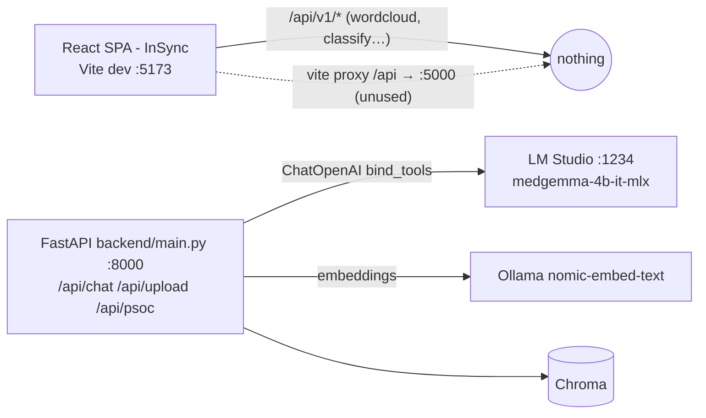

---
tags:
  - codebase
  - integration
  - plan
date: 2026-10-25
---
# Integration Plan: Frontend ↔ Backend ↔ LM Studio

Hub note. Details are in [[Backend Overview]], [[Backend - LLM Integration Points]], [[Frontend Overview]], [[Frontend - API Contract]] and [[LM Studio - Local LLM Endpoint]].

## Current state (verified 2026-10-25)

The frontend and backend currently share **zero** endpoints.

## Blockers (all verified by reading the code)
### Frontend won't boot
- `frontend/index.html:11` loads `/src/main.jsx`, but the file is `main.tsx`.
- `frontend/vite.config.ts:1` reads `port { defineConfig }`, which is a broken `import`.
- The Tailwind v4 Vite plugin is missing from the config.

### Backend won't start
- `backend/agent.py:25`: `tools = [search_vector_db]` is undefined, so a NameError is raised at import.
- `langchain-openai` is not in `pyproject.toml`.
- The model is the placeholder `YOUR_LOADED_MODEL_ID`.

### Chat design mismatch
`agent.py` uses `bind_tools` and a tool loop, but medgemma has **no tool-use** support.

### Duplicates
`backend/fron.py` is byte-identical to `frontend/backend/topic_router.py` (BERTopic `/api/v1/*` routes), and neither is mounted.

## Proposed steps
1. **Fix boot blockers** in both apps.
2. **Rewrite LLM layer.** Add `backend/llm.py`, a thin client for `POST /api/v1/chat` (`model`, `system_prompt`, `input`), configured via env vars `LMSTUDIO_BASE_URL` and `LMSTUDIO_MODEL=medgemma-4b-it-mlx`. Change `run_agent` to retrieve first: call `search_documents(query)`, format the context with source and page, then make one LM Studio call. The `chat_routes.py` signature stays the same.
3. **Embeddings.** Optionally switch to LM Studio `embeddinggemma-2` via `/v1/embeddings`. This needs a new Chroma collection and re-ingest.
4. **Wire the frontend to the backend.**
   - Make `API_BASE` the backend root `http://127.0.0.1:8000`, or use the Vite proxy to `:8000`.
   - Add typed clients: `chat(query) → {answer, suggestions}`, `uploadReport(file)`, `predictPcos(form)`.
   - Mount the `topic_router` in `main.py` so the word cloud works, or let it keep falling back to the static JSON.
5. **UI hookups.**
   - The PCOS questionnaire calls `/api/psoc`. Map the fields to the training column names and send form-encoded numbers.
   - The Report Simplifier uploads, then calls chat to explain the report.
   - Add a chat panel, which doesn't exist yet.
6. **Hardening.** Restrict CORS to the dev origin, load the model path relative to `__file__`, and fix the suggestions parsing bug in `chat_routes.py`.

## Status (2026-10-25)
Verified end to end through the Vite proxy (`http://localhost:5173/api/...`), with LM Studio at :1234.

| Check | Result |
|---|---|
| Static contract (paths, methods, JSON vs multipart, field names) for `insync.ts`, `research.ts`, `client.ts` | Pass, no mismatches |
| `GET /api/health` | Pass: `{status:"online", llm:{reachable:true, model:"medgemma-4b-it-mlx", base_url:"http://localhost:1234"}}` |
| `POST /api/chat` with a history turn | Pass: `{answer, suggestions, sources}` returned |
| `POST /api/psoc` with the frontend payload (16 exact column keys, nulls) | Pass: probability 0.31, prediction 0, `missing_fields` lists the 5 null fields |
| `Cycle(R/I)` validation | Pass: 3 is rejected with 422; frontend sends 2 (regular) or 4 (irregular) or null |
| `POST /api/report/explain` with a generated lab PDF (Hb 10.9, TSH 2.1, Vit D 14) | Pass: 200 in about 7 s, tests classified below/within/below, glossary and questions present |
| Follow-up `/api/chat` with the returned `source_id` | Pass: `sources` cites `labtest.pdf` page 1 |
| `/api/v1/*` topic routes (wordcloud, drill-down, classify, export-cloud-image) | Pass: clean 503 with a `detail` message each |
| `GET /` on the Vite dev server | Pass: 200 |
| `pnpm build` in `frontend/` | Pass: 42 modules, built with no errors |

No code fixes were needed. Test data was cleaned up (uploads copies, Chroma chunks for `c61b37dab7` and `ddff03f5d2`).

## Decision log
- **Retrieve-then-answer instead of tool calling.** medgemma is not trained for tool use, so `run_agent` retrieves chunks first and makes one LM Studio call.
- **nomic-embed-text-v1.5 embeddings via LM Studio.** embeddinggemma fails to load in MLX.
- **PCOS takes JSON with nullable fields.** The saved pipeline imputes missing values and the response lists `missing_fields`.
- **The topic router degrades to 503 without BERTopic.** The word cloud falls back to the static `/cloud_terms.json` on the frontend.

## How to run
1. Start LM Studio and load both models:
   - `~/.lmstudio/bin/lms load medgemma-4b-it-mlx -y`
   - `~/.lmstudio/bin/lms load text-embedding-nomic-embed-text-v1.5 -y`
2. Backend: `cd backend && ../.venv/bin/uvicorn main:app --port 8000`
3. Frontend: `cd frontend && npx --yes pnpm@10 dev --port 5173`, then open http://localhost:5173

## Remaining gaps
- ~~Vite binds to `localhost` (IPv6 `::1`), so `http://127.0.0.1:5173` refuses connections.~~ **Resolved 2026-10-25:** `server.host: true` in `frontend/vite.config.ts` (proxy kept). Both `http://localhost:5173` and `http://127.0.0.1:5173` return 200.
- ~~Chat without a `source_id` retrieves from every ingested document; a PCOS question pulled in unrelated hackathon-brief chunks.~~ **Resolved 2026-10-25:** `chunks.search_documents` now returns each hit's `distance`, and `agent.retrieve` drops hits above `RAG_MAX_DISTANCE` (env var, default **0.85**, documented in `backend/.env.example`). When a `source_id` is given the threshold is skipped, because the user scoped the question explicitly.
  - Why 0.85: the collection uses Chroma's default `l2` space (hnsw:space), and lower means more similar. With nomic-embed-text-v1.5, relevant PCOS chunks scored 0.28 to 0.76 (symptoms query 0.28, metformin 0.57, LH/FSH ratio 0.76). The off-topic hackathon-brief chunks scored 0.94 to 1.20 for the same queries. 0.85 sits in the gap, and off-topic questions (sourdough, capital of France) returned no hits. Re-tune if the embedding model changes.
- The BERTopic data (`document_store.json`, `cloud_terms.json`, the model) and the `bertopic` and `wordcloud` packages are absent, so topic routes return 503.
- The Chroma collection is now empty, so general RAG has no knowledge base until the research PDFs are re-ingested.
- Model answers occasionally contain a trailing "Safety Notes" line, and the suggestion parsing relies on the model following the format.
- Uploaded files are saved under `backend/uploads/<date>/` and are never cleaned up.
- No automated tests for the new routes.
