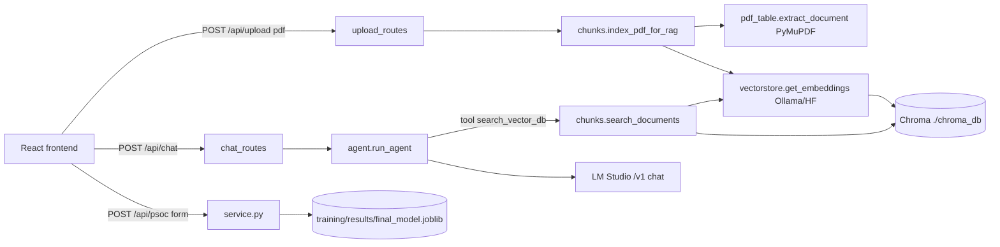

---
tags:
  - codebase
  - backend
---
# Backend Overview

Location: `backend/` (flat module layout, no package). Python >=3.13, deps in root `pyproject.toml`. See [[Backend - LLM Integration Points]] for the LM Studio switch.

## Real entrypoint
`backend/main.py` -> `app = FastAPI(title="Document Chat")` (see [[backend - main.py]]). It mounts three routers: [[backend - upload_routes.py]], [[backend - chat_routes.py]], [[backend - service.py]].

**It currently cannot start**: `main.py:4` -> `chat_routes.py:6` -> `agent.py:25` raises `NameError: search_vector_db` (see [[backend - agent.py]]). Also `agent.py:7` imports `langchain_openai`, which is NOT in `pyproject.toml`.

## File classification
| File | Role |
|---|---|
| main.py | Real app entrypoint (RAG chat + upload + PCOS) |
| agent.py | LLM agent loop (broken, see note) |
| chat_routes.py | POST /api/chat |
| upload_routes.py | POST /api/upload |
| service.py | POST /api/psoc (PCOS model) |
| chunks.py | chunk + embed + search |
| vectorstore.py | Chroma + embedding factory |
| pdf_table.py | PyMuPDF table/text extraction |
| fron.py | Actually `topic_router.py` (word-cloud/BERTopic router) misnamed. Not mounted by main.py. See [[backend - fron.py]] |
| onemain.py | Alternative app for the InSync word-cloud service; imports `topic_router` which does not exist under that name. Dead as-is. See [[backend - onemain.py]] |
| insynccc.py | Exported Colab notebook (`!pip`, `google.colab`): NOT valid Python, never imported. Generated the BERTopic artifacts. See [[backend - insynccc.py]] |
| ../main.py | Hello-world stub, irrelevant |

## Route table
| Method | Path | Request | Response |
|---|---|---|---|
| GET | `/` | - | `{"status":"online"}` |
| POST | `/api/chat` | JSON `{"query": str}` | `{"answer": str, "suggestions": [str]}`; 400 empty query; 500 `{detail}` |
| POST | `/api/upload` | multipart, field `file` (.pdf) | `{"status":"indexed","stored_at":str,"source_id","filename","pages","chunks_indexed","text_chunks","table_chunks","tables_found","tables_joined_multipage"}` or `{"status":"already_indexed","source_id","filename"}`; 400 non-pdf, 413 >50MB, 500 indexing failed |
| POST | `/api/psoc` | **form-encoded** (not JSON), 16 fields by alias | `{"pcos_probability": float, "prediction": 0|1}`; 422 on validation |

Not mounted (only in fron.py/onemain.py, prefix `/api/v1`): GET `/wordcloud`, GET `/drill-down`, POST `/classify`, GET `/export-cloud-image`, GET `/charts/{chart_name}`.

## CORS / ports
`main.py:10-16`: `allow_origins=["*"]` with `allow_credentials=True`, all methods/headers. No port configured in code; no `uvicorn.run`. fron/onemain docs suggest 8000. onemain.py has its own CORS (env `INSYNC_ALLOWED_ORIGINS`) and a Private-Network-Access header middleware.

## Data flow


## Run (updated)
```
cd backend
../.venv/bin/uvicorn main:app --port 8000     # Vite dev server (:5173) proxies /api to :8000
```
Copy `backend/.env.example` to `backend/.env` to configure (LM Studio URL and models, EMBEDDING_BACKEND, INSYNC_DATA_DIR, CORS_ORIGINS). Health check: `GET /api/health`. `fron.py` is now `topic_router.py` and is mounted by main.py; its endpoints return 503 until bertopic and the data files are present. Details in [[backend - main.py]].

## Run (older)
```
cd backend            # required: flat imports + '../training/results/...' relative path
uv run uvicorn main:app --port 8000 --reload
```
Prereqs: embedding server (default Ollama `nomic-embed-text` on :11434), LM Studio on :1234. No `.env` exists in backend/.

## Env vars
CHROMA_DIR, COLLECTION_NAME, EMBEDDING_BACKEND (ollama|sentence_transformers), OLLAMA_EMBED_MODEL, ST_EMBED_MODEL, CHUNK_SIZE, CHUNK_OVERLAP, TABLE_CHUNK_CHARS, UPLOAD_DIR, MAX_UPLOAD_MB, INSYNC_DATA_DIR, INSYNC_ALLOWED_ORIGINS.

## Dependency check (pyproject.toml)
Present: chromadb, fastapi, langchain-core, langchain-huggingface, langchain-ollama, langchain-text-splitters, pymupdf, python-dotenv, python-multipart, scikit-learn (brings joblib), pandas, uvicorn.
Missing: `langchain-openai` (agent.py), `bertopic`, `wordcloud`, `umap-learn` (fron.py/insynccc.py, only needed if InSync service is used). `pydantic` is transitive via fastapi.

## Top issues
1. agent.py NameError blocks startup; `search_vector_db` tool never defined.
2. Tool calling won't work with medgemma-4b (no tool use).
3. Placeholder model id `YOUR_LOADED_MODEL_ID` (agent.py:16).
4. `/api/psoc` takes Form, not JSON; model loaded at import with CWD-relative path.
5. CORS `*` + credentials.
6. Follow-up parsing bug with bold marker, see [[backend - chat_routes.py]].
7. No hardcoded real secrets found (agent.py:15 `api_key` is LM Studio's dummy placeholder).
