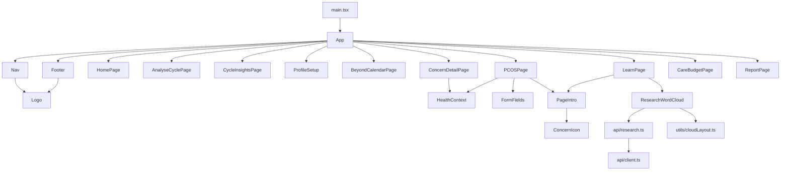

# Frontend Overview

"InSync" (index.html:7 title `insync`; package name `figma-make-app`, package.json:2) is a menstrual-health education and tracking SPA. React 19 + Vite 8 + TypeScript 5.7 + Tailwind v4 (imported in `src/index.css:2`, but styling is almost all hand-written global CSS, 590 lines). Scaffolded by Figma Make. Path: `research_womens_safety/frontend/`.

Related: [[Frontend - API Contract]], [[Frontend - API Module]], [[Frontend - Components]], [[Frontend - Pages]], [[Frontend - Types]], [[Frontend - backend topic_router]], [[Frontend - Conventions]].

## User flows
1. Home (`#home`) -> "Get Started" -> My Cycle (`#analysis`): log period entries (start/end/ongoing, flow, pain 0-5, symptoms, notes). Entries held in App state only.
2. Profile (`#profile`): name, age, height, weight, first period date, cycle length. Validation client-side.
3. Insights (`#insights`): computed locally from entries (cycle length, durations, recurring symptoms).
4. Concerns (`#concerns`) -> PCOS (`#pcos`, 5-step questionnaire) or Endometriosis / Dysmenorrhea / Heavy bleeding / Irregular (`ConcernDetailPage`). Summary only; no scoring or submission.
5. Learn (`#info`): articles (static) plus `ResearchWordCloud` - the ONLY networked feature. Word cloud, passage drill-down, "find related theme", PNG download, BERTopic chart iframes.
6. Care Budget (`#care-budget`): local-only budget/essentials/shopping/expenses/calculator (INR).
7. Report Simplifier (`#lab-report`): file picker (PDF/JPG/PNG <=10MB); real uploads show "Automated analysis not connected in prototype" (ReportPage.tsx:117); only a fictional sample report renders results.

## Architecture
- No router lib: hash routing. `App.tsx:14-40` maps `location.hash` <-> `Page` union; `navigate(page, focus?)` (App.tsx:25).
- State: `useState` in App only: `page`, `profile`, `entries`, `learnFocus` (App.tsx:20-23). Everything is in-memory; lost on reload. No localStorage/Context/Redux.
- Network: only `src/api/*` -> FastAPI research service. No chat/LLM/PCOS-model call exists in the UI today.

(Button is used everywhere.)

## Run instructions
- Toolchain: `.mise.toml` node 22, pnpm 10.34.3. Lockfile `pnpm-lock.yaml`.
- `pnpm install`; `pnpm dev` (vite); `pnpm build`; `pnpm preview`; `pnpm format` (oxfmt). No test/lint/typecheck scripts (tsc is `noEmit`, run manually `pnpm exec tsc`).
- `.env.example`: `VITE_API_BASE=http://127.0.0.1:8000/api/v1`. Copy to `.env`.

## Red flags found
- `index.html:11` loads `/src/main.jsx` but the entry is `src/main.tsx` -> app will not boot until fixed.
- `vite.config.ts` has no Tailwind plugin and no `@` alias, contrary to AGENTS.md; line 1 as read begins `port {` (apparent `im` missing - verify the file; may be display/hook artifact). See [[Frontend - API Contract]] for proxy mismatch.
- `package.json` lists `@tailwindcss/vite` but it is unused in config.
